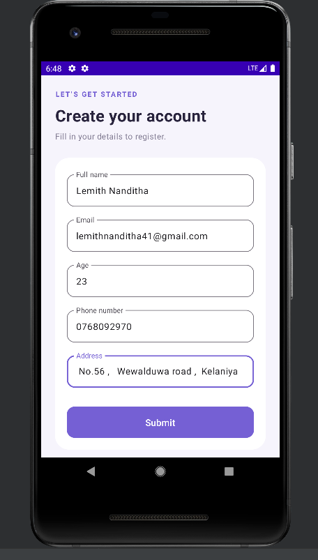

# Simple Registration App

A simple Android application built using Kotlin and Jetpack Compose
for a mobile application development assignment.

## Features

- Registration form with the following fields:
  - Full name
  - Email
  - Age
  - Phone number
  - Address
- Submit button enabled when all fields are filled.
- Success screen displayed after submission.
- Back to form button.

## Screenshots

### Registration Form

### Registration Successful

## Technologies Used

- Kotlin
- Jetpack Compose
- Material Design 3
- Android Studio
- Gradle

## Run the Project

1. Clone this repository.
2. Open the project in Android Studio.
3. Allow Gradle Sync to complete.
4. Select an Android emulator or connected device.
5. Click Run.

## Note

This application demonstrates a registration UI and screen navigation.
Registration details are not saved to a database.
